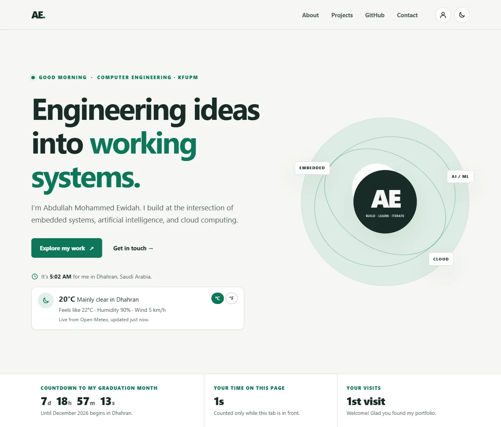
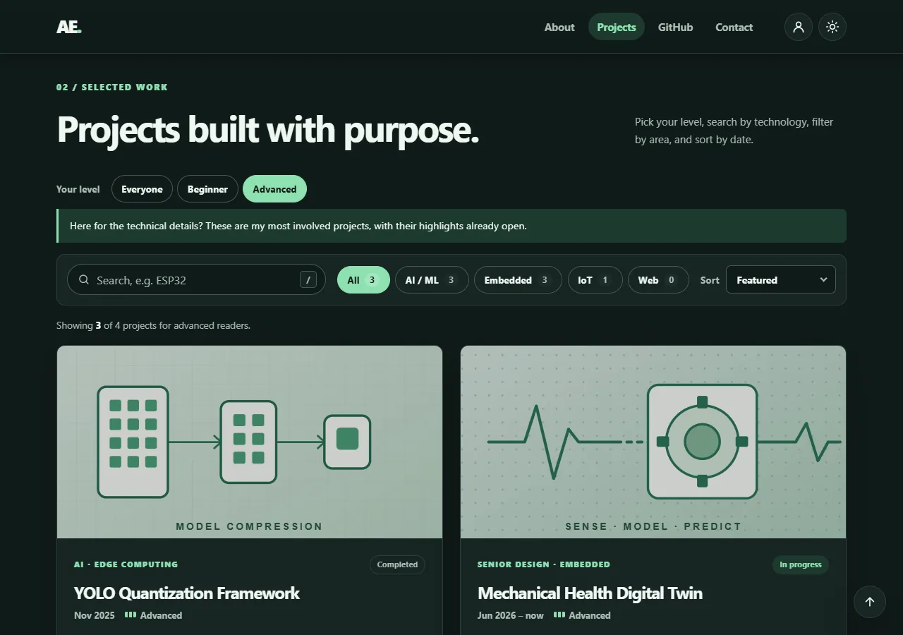
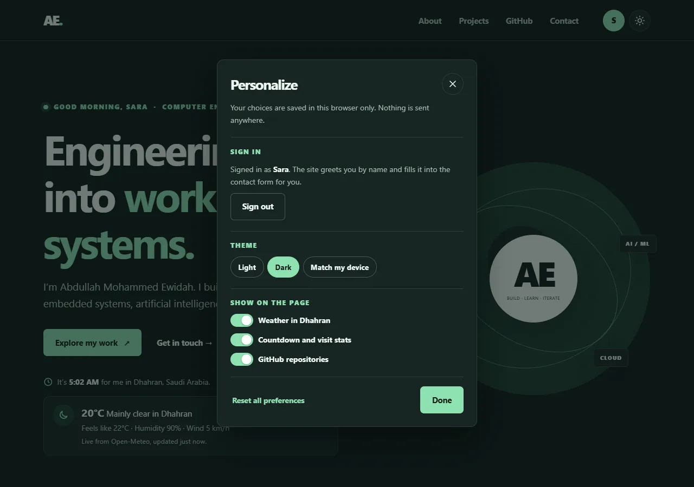
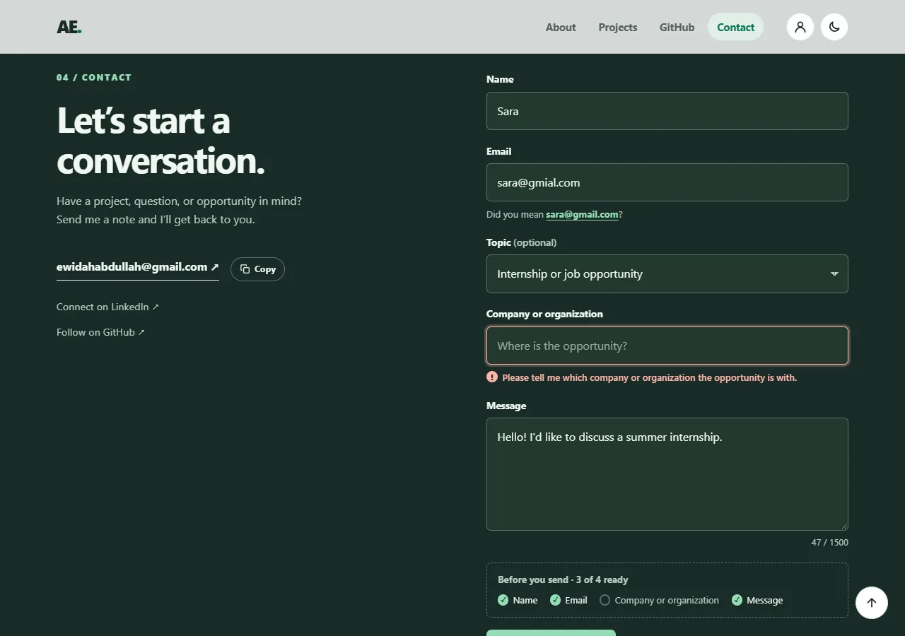
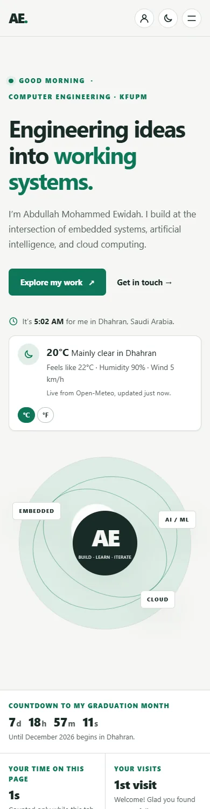

# Abdullah Ewidah — Portfolio with Advanced Functionality

My personal portfolio website for **SWE 363, Assignment 3: Advanced Functionality**. It builds on my [Assignment 2 portfolio](https://github.com/abooodi123/202244620-abdullahewidah-assignment2). This version adds:

- live data from a second public API: the weather in Dhahran;
- a central state store that remembers each visitor and keeps open tabs in sync;
- multi-step logic: reader levels, date sorting, and conditional form rules;
- live timers;
- a performance pass guided by Lighthouse.

It is written in plain HTML, CSS, and JavaScript, with no frameworks, libraries, or build step.

**Live site:** https://abooodi123.github.io/202244620-abdullahewidah-assignment3/



---

## Contents

- [What's new in Assignment 3](#whats-new-in-assignment-3)
- [Features by requirement](#features-by-requirement)
- [Run it locally](#run-it-locally)
- [How to use the site](#how-to-use-the-site)
- [Project structure](#project-structure)
- [Testing and quality](#testing-and-quality)
- [Performance](#performance)
- [Browser support](#browser-support)
- [AI use (summary)](#ai-use-summary)
- [Documentation](#documentation)

---

## What's new in Assignment 3

The first commit is an unchanged copy of Assignment 2, so `git diff 285135e` shows every change. Each feature was built on its own branch and merged with `--no-ff`, so the history shows one merge per feature.

| Area | Assignment 2 | Assignment 3 |
| --- | --- | --- |
| External APIs | GitHub repositories | GitHub **and** live Dhahran weather (Open-Meteo), sharing one fetch helper and one cache helper |
| State | A few separate `localStorage` keys | One **state store** with a schema, validation, subscriptions, and sync across tabs |
| Visitor | Anonymous | **Sign in** with a name (simulated login), personal greeting, visit counter |
| Projects | Search, area filter, 3 sort orders | Adds **reader levels** (Beginner / Advanced), **dates**, Newest and Oldest sorting, and smarter empty states |
| Contact form | Validation and drafts | Adds a **conditional Company field**, an **email typo suggestion**, and a live **checklist** |
| Timers | Dhahran clock | Adds a **graduation countdown**, **time on page**, and a shared ticker that pauses in background tabs |
| Customization | Theme toggle | A **Personalize** dialog: sign in, three theme choices, show or hide sections, reset everything |
| Performance | Lighthouse mobile 100 | New features first cost 2 points (98); fixed back to **100** with 0 ms blocking time |
| Browsers tested | Chrome, Edge | Chrome, Edge, **Firefox**, and **WebKit (Safari's engine)**, on desktop and phone sizes |
| Automated checks | 63 | **178** in-page checks + **116** cross-browser checks |

---

## Features by requirement

### 2. API integration

- **GitHub REST API:** my public repositories, with a forks switch, sorting, *Show all*, and *Refresh*. Results are cached for 30 minutes.
- **Open-Meteo weather API (new):** the current weather in Dhahran, shown next to my local time: temperature, conditions, feels-like, humidity, and wind. It also shows a short local remark, such as "A classic Eastern Province scorcher." It is free and needs no API key. Readings are cached for 15 minutes, and switching between °C and °F needs no new request.
- **User-friendly errors:** both APIs share one helper, `fetchJson`. It has an offline check and a timeout, and it tags each error with a kind: offline, timeout, rate limit, not found, server error, or network. Each kind gets its own plain-language message and a **Try again** button. Bad or non-JSON data is rejected instead of showing "NaN°C". If a refresh fails, an older saved copy is shown and labeled with its age.

### 3. Complex logic

- **Projects you can filter *and* sort:** pick a level, an area, and a search term, then sort, for example Web → Newest first. Every step runs through one function, `isVisible`, so the chip counts, the summary, and the URL always agree.
- **Different content for different visitors:**
  - **Beginner** shows the beginner and intermediate projects, and adds an *In plain words* explanation to each card.
  - **Advanced** shows the intermediate and advanced projects and opens their technical highlights.
  - Each level has its own message.
- **Empty states that find the real cause:** when nothing matches, the site checks one step at a time (area, then level) to find what removed the results. If both are to blame, it offers both fixes.
- **Contact form with extra checks:**
  - Choosing *Internship or job opportunity* reveals a required **Company** field.
  - Common email typos (`gmial.com`, `gmail.co`, …) get a one-click *Did you mean …?* suggestion.
  - A live checklist ticks off each required field.
  - The form opens an email draft only after every active field passes.
- **Timers and counters:**
  - **Graduation countdown:** counts down to December 2026 and has three phases (before, during, after).
  - **Time on page:** counts only while the tab is in front.
  - **Visit counter:** reloads don't count as new visits.

### 4. State management

- **One store for everything remembered** (`createStore` in `script.js`). Each value has a storage key, a default, and a validity check. Features subscribe to the values they use and re-render when those values change.
- **Simulated login and logout:** sign in with just a name in the Personalize dialog. The site then greets you by name, shows your initial in the header, welcomes you back on later visits, and fills in the contact form's Name field. Signing out removes the name.
- **Light, dark, or match my device**, remembered with no flash of the wrong theme on load.
- **Show or hide sections:** the weather card, the stats band, and the GitHub section. A hidden section's navigation link is hidden too.
- **Remembered choices:** the reader level, the temperature unit, and the forks switch, plus a **Reset all preferences** button.
- **Tabs stay in sync:** change the theme or sign in in one tab, and every other open tab updates within a moment.

### 5. Performance

See [Performance](#performance) below: Lighthouse **100** on mobile and desktop, after removing a forced layout and a layout shift that the new features had introduced.

---

## Run it locally

You only need a modern web browser. Nothing has to be installed to run the site.

### Option 1: open the file (quickest)

1. Download the repository: click **Code → Download ZIP** on GitHub and unzip it, or clone it:
   ```bash
   git clone https://github.com/abooodi123/202244620-abdullahewidah-assignment3.git
   cd 202244620-abdullahewidah-assignment3
   ```
2. Double-click `index.html` to open it in your browser.

### Option 2: use a local web server (closest to the live site)

Run **one** of these from the project folder, then open the address it prints:

```bash
python -m http.server 8000        # then open http://localhost:8000
npx serve .                       # needs Node.js; then open the URL it prints
```

In VS Code you can also right-click `index.html` and choose **Open with Live Server** (this needs the Live Server extension).

### Good to know

- **The weather and GitHub sections need an internet connection.** Offline, each shows a friendly message and loads by itself once you reconnect.
- **GitHub allows 60 requests per hour** for visitors who are not logged in. The site caches results for 30 minutes, so normal browsing stays well under that limit. If the limit is reached (for example, on a busy shared network), the site says so, shows when to try again, and offers a link to my profile.
- **Your preferences stay in your browser.** Your name, theme, and choices are saved in `localStorage` on your own device and never sent anywhere. *Personalize → Reset all preferences* removes them.
- **The contact form opens your email app** with a ready-to-send draft. The site has no server, so nothing is sent until you press Send in your email app.

### Publish with GitHub Pages (optional)

In the repository, open **Settings → Pages**. Under **Build and deployment**, choose **Deploy from a branch**, select `main` and `/ (root)`, and click **Save**. After a minute or two, the site appears at the live link above.

---

## How to use the site

| To… | Do this |
| --- | --- |
| Sign in so the site greets you | Click the **person icon** in the header, type your first name, and click **Sign in**. No password is needed. |
| Sign out or reset everything | Open the same dialog and click **Sign out**, or **Reset all preferences**. |
| Switch the theme | Click the sun or moon button, or choose **Light**, **Dark**, or **Match my device** in Personalize. |
| Hide the weather, stats, or GitHub section | In Personalize, turn the switch under **Show on the page** off. |
| See °F instead of °C | Click **°F** on the weather card. Your choice is remembered. |
| See projects for your level | Under **Your level**, choose **Beginner** (plain-language explanations) or **Advanced** (technical highlights open). |
| Sort projects by date | In **Sort**, choose **Newest first** or **Oldest first**. It combines with the level, area, and search. |
| Search projects | Type in the search box, or press **/** anywhere to jump to it. **Esc** clears it. |
| Share a filtered view | Copy the address bar. It includes your level, area, search, and sort, for example `?view=advanced&sort=newest`. |
| Ask me about a job or internship | Choose that topic in the contact form; a **Company** field appears. The checklist shows what is still needed. |
| Get the newest data | Click **Refresh** in the GitHub section or **Try again** on any error message. |

| Reader levels and dates (dark theme) | Personalize dialog (signed in) |
| --- | --- |
|  |  |

| Contact form rules | Phone layout |
| --- | --- |
|  |  |

---

## Project structure

```text
202244620-abdullahewidah-assignment3/
├── index.html                  # Page structure and content (readable without JavaScript)
├── css/
│   └── styles.css              # Design tokens, components, responsive rules, motion
├── js/
│   └── script.js               # Helpers, the state store, and one init function per feature
├── assets/
│   └── images/                 # Project illustrations and favicon (SVG, 7 KB in total)
├── docs/
│   ├── ai-usage-report.md      # AI tools, usage log, and declaration
│   ├── technical-documentation.md
│   └── screenshots/            # Images used in this README (WebP)
├── tests/                      # Optional automated browser tests (Node.js)
├── .gitattributes              # Consistent line endings across operating systems
├── .gitignore
└── README.md
```

---

## Testing and quality

### Automated in-page tests (optional)

`tests/` drives the real page in headless Chrome or Edge with Puppeteer: **178 checks in 11 suites**. The five new suites cover Assignment 3:

| Suite | What it checks |
| --- | --- |
| `state.test.js` | Sign in and out, rejected names, theme choices, hidden sections, values kept after a reload, **sync between two tabs**, damaged saved values, reset |
| `levels.test.js` | Beginner and Advanced rules, date sorting, how level, area, and search combine, every empty-state explanation, a shared link taking priority over the saved level |
| `weather.test.js` | Live API, unit conversion, cache reuse, remarks, simulated **500, 429, network failure, bad data, non-JSON, and timeout**, retry, an older copy, hiding the card, no JavaScript |
| `timers.test.js` | Every countdown phase with a **simulated clock** (including the last second before December), pause while hidden, visit counting across sessions, exactly one 1-second timer |
| `form-rules.test.js` | Company rule, blocked submission, email suggestions, checklist, and the subject and body of the email draft |

```bash
cd tests
npm install     # installs puppeteer-core (uses your installed Chrome or Edge) and Playwright
npm test        # the 11 in-page suites
```

If GitHub's hourly limit for your network is used up, the live GitHub checks report **SKIP** instead of failing, and the simulated failures still run.

### Cross-browser tests (optional)

```bash
cd tests
npx playwright install firefox webkit    # one-time download of the test browsers
npm run test:browsers
```

This runs the main features in **Chrome, Edge, Firefox, and WebKit** at desktop size and on a phone-sized touch screen. Every browser passed all **116 checks** with no JavaScript errors (see [Browser support](#browser-support)).

### Lighthouse

See [Performance](#performance).

---

## Performance

Measured with Lighthouse 12 on a local server (three mobile runs, with identical results):

| | Performance | Accessibility | Best practices | SEO |
| --- | --- | --- | --- | --- |
| Mobile | 100 | 100 | 100 | 100 |
| Desktop | 100 | 100 | 100 | 100 |

The new features first lowered the mobile score to 98, so I fixed what Lighthouse reported:

| Metric (mobile) | Before the fix | After |
| --- | --- | --- |
| Total blocking time | 100 ms | **0 ms** |
| Forced layout during start-up | 87 ms | **none** |
| Largest contentful paint | 2.1 s | **1.9 s** |
| Cumulative layout shift | 0.002 | **0.001** |

What made the difference:

- **No forced layout at start-up.** Measurements of the page (the tab indicator, the scroll position) wait for the next animation frame.
- **A stable weather card.** The weather loads with a skeleton that has the same parts as a real reading, and the card keeps a reserved height, so nothing jumps when the data arrives.
- **Faster API calls.** The page connects to the weather API early and starts the GitHub DNS lookup ahead of time.
- **Lighter images.** Screenshots are WebP, 195 KB for five images instead of 444 KB for three PNGs. Unused images were removed.
- **Less background work.** One shared 1-second timer drives every counter and stops while the tab is hidden. The weather refreshes when you come back to the tab instead of polling in the background.
- **No GitHub request when it isn't needed.** The GitHub API is called only when its section is near the screen. A section you have hidden makes no request at all.

Gzip sizes: HTML 8.8 KB, CSS 11.2 KB, JS 23.5 KB. There are no fonts, frameworks, or libraries to download.

---

## Browser support

| Browser (engine) | Version tested | Desktop | Phone size |
| --- | --- | --- | --- |
| Google Chrome (Chromium) | 157 | ✅ 14/14 | ✅ 15/15 (iPhone 13 emulation) |
| Microsoft Edge (Chromium) | 158 | ✅ 14/14 | ✅ 15/15 (iPhone 13 emulation) |
| Mozilla Firefox (Gecko) | 159 | ✅ 14/14 | ✅ 15/15 (390 px touch window) |
| WebKit (Safari's engine) | 27.2 | ✅ 14/14 | ✅ 15/15 (iPhone 13 emulation) |

These tests ran on Windows. WebKit is the engine inside Safari, but it is not Safari itself, so a check on a real iPhone or Mac is still worth doing.

Newer features are used only where the browser supports them, so older browsers still get a working page:

- **View Transitions:** used only if present, and never in background tabs.
- **`<dialog>`:** browsers without it simply don't show the Personalize button.
- **Clipboard API:** falls back to an older copy method.
- **Without JavaScript:** every project and About panel stays readable. The weather card and stats band, which need JavaScript, are hidden.

---

## AI use (summary)

I built this assignment with **Claude Code** (Anthropic, Claude Opus 5.5 model) in VS Code, in one conversation. I gave it the assignment brief and my project dates, and it:

- read my Assignment 1 and 2 work;
- planned the features and branches;
- wrote the code, the tests, and these documents;
- ran every test suite, Lighthouse, and the cross-browser checks.

The testing found **real bugs**, and they were fixed before merging:

- a theme switch that failed in background tabs;
- a countdown that screen readers read as "7d19h";
- an empty-state message that blamed the wrong filter;
- a forced layout costing 87 ms on phones.

Every AI-assisted commit has an `Assisted-by:` line. The full report, with the usage log and my declaration, is in [docs/ai-usage-report.md](docs/ai-usage-report.md). The complete conversation and the intermediate artifacts are in the AI Evidence ZIP submitted on Blackboard, which is not in this repository.

---

## Documentation

- [Technical documentation](docs/technical-documentation.md): architecture, the state store, API integration, logic flows, performance, compatibility, security, testing, and limitations.
- [AI usage report](docs/ai-usage-report.md): tools, use cases, benefits and challenges, what I learned, responsible use, the usage log, and the declaration.

---

© 2026 Abdullah Mohammed Ewidah · Computer Engineering, KFUPM · [LinkedIn](https://www.linkedin.com/in/abdullah-ewidah-0a548b329/) · [GitHub](https://github.com/abooodi123)
